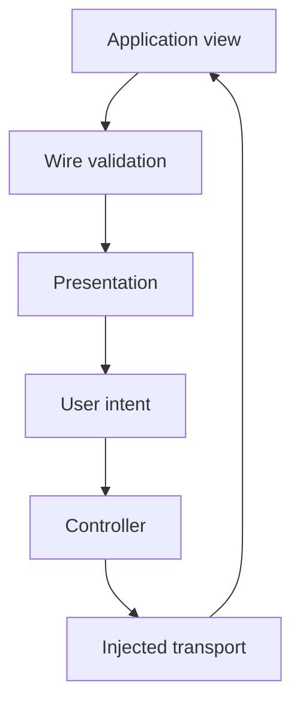

# Tempo Core Components

The presentation boundary for Tempo 2. This initial package is a dependency-free
ES module with TypeScript declarations. No frontend framework is selected.

## Public interface

| Export | Responsibility |
| --- | --- |
| `validateStudyView(value)` | Validate external wire version 1 data and return an immutable copy. Missing, malformed, unknown and extra fields are rejected. |
| `renderStudy(view, state?)` | Return escaped HTML from a validated view; no event handlers or network access. |
| `createStudyController({ transport, render, makeSubmissionId })` | Translate user intent into commands using the current server-issued IDs and revision. |

The controller exposes `next()`, `resume(attemptId)`, `answer(uci)`, `abandon()`,
`retry()` and `getState()`. Its `transport.send(command)` returns a promise of an
external view. Its render callback receives `(view, { busy, canRetry })` and may
pass those arguments to `renderStudy`. The application supplies a fresh, stable
submission ID for each new answer or abandonment; retry reuses the original.

All async action methods resolve to the returned view. An action suppressed
because another is busy resolves to `null`. Transport failures and malformed
replies reject their promise; the unresolved command remains available for
`retry()`. A retryable application error also retains that command. New intents
are refused until an unresolved command is recovered. A non-retryable error
clears the command so the caller can resume or request another exercise.

An attempt view carries its content/dataset identity, response revision, prompt,
feedback and optional assessment. Ready views require a prompt; complete and
abandoned views have no prompt. Empty and error are separate variants. The
complete wire types are in [src/index.d.ts](src/index.d.ts). IDs are nonempty
strings; decision indexes start at zero. No solution is included in the view.

This is a runtime request/response loop. It does not introduce a package import
from the UI into Study, Queue, Learning, Chess or Store. Domain decisions remain
behind the application transport.

## What is real and what is deferred

The versioned view validation, HTML escaping, intent construction, response
revision propagation, busy guard and reuse of unresolved submission IDs are
implemented. The UI has no answer key, grader, eligibility policy, scheduler,
persistence or provider access. A failed tactic may remain ready for corrective
input while displaying the application's `again` assessment; the UI does not
change it to `good`.

The renderer shows a FEN placeholder instead of a graphical board. Styling,
interactive board graphics, browser event binding and a production network
transport are future adapters. Consumers attach events through the
`data-action` attributes and inject their transport; no HTTP endpoint is assumed.

## Validation

Run `npm test` with Node 18 or newer. Tests use Node's built-in test runner and
require no installed dependencies. They cover strict wire validation, escaping,
command contents, abandonment, busy behavior, retryable/final errors and lost
responses. Application-owned integration tests should run the real Rust
application through its transport and feed these same exports; local fake
transport tests alone do not establish that integration.
